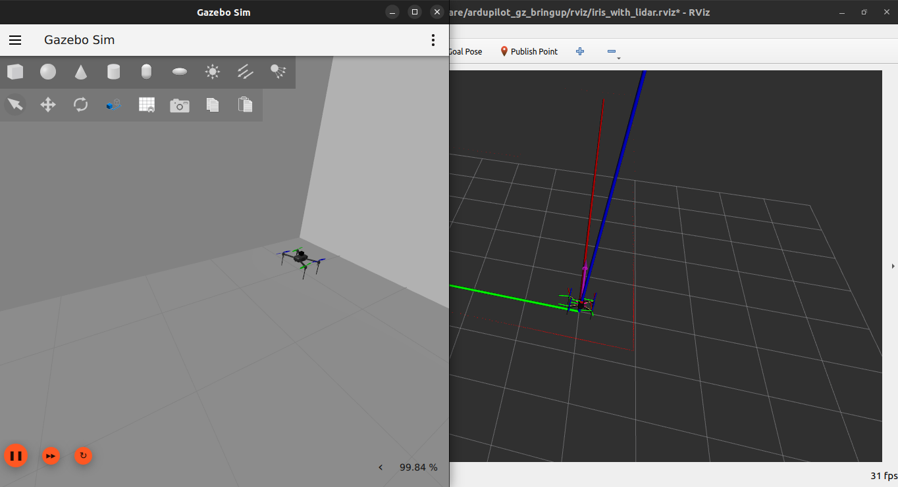
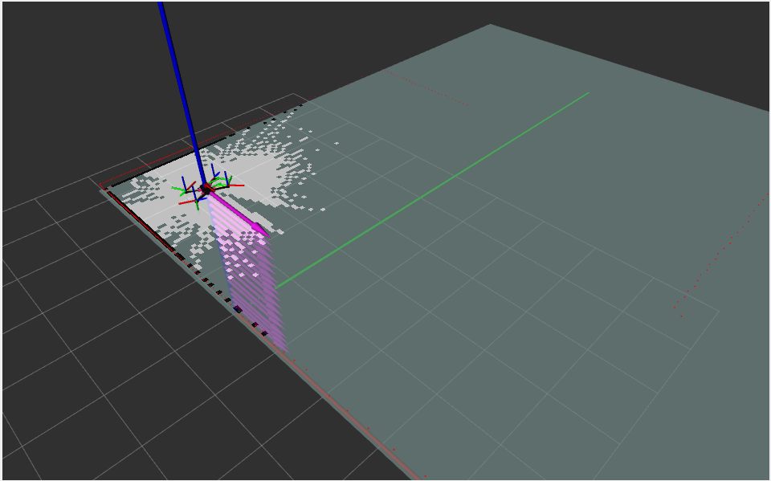
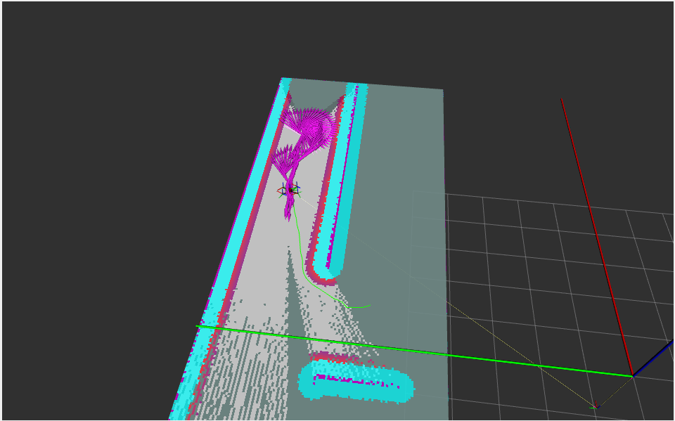
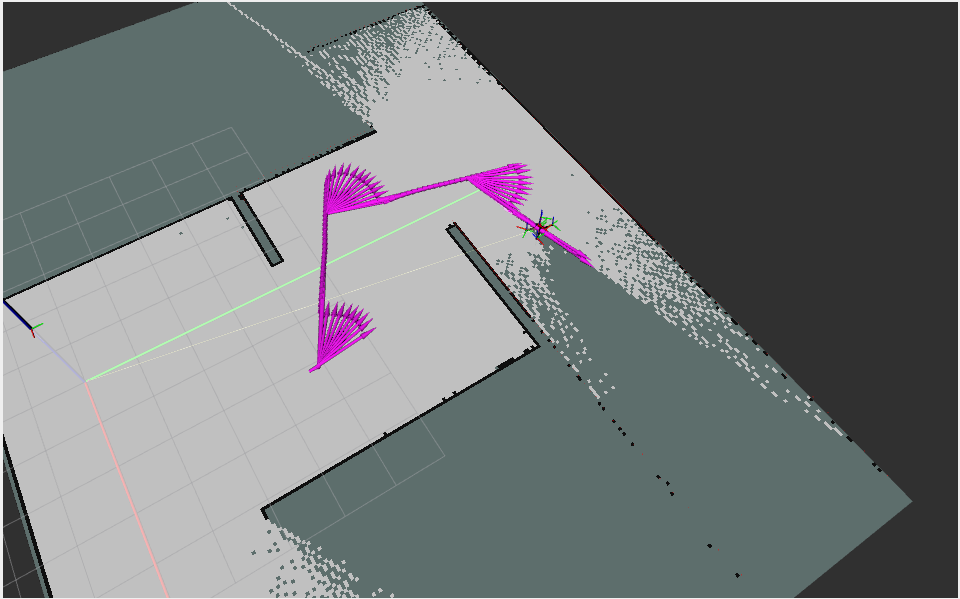

# NIDAR 2026-27 — Autonomous Maze Exploration for a GPS-Denied Drone

A ROS 2 + Gazebo + ArduPilot SITL stack that flies a multirotor through an
unmapped, GPS-denied indoor maze, builds its own map with SLAM, and
autonomously explores the entire building using frontier-based exploration —
built for **NIDAR's Air Mouse track** (Aerial Guild).

This repo is a snapshot of that build journey: environment setup, flying the
stock example maze, generating a competition-spec maze, the controller
failures that came with it, and the fix that finally made autonomous runs
reliable.

<p align="center">
  <br>
  <em>Drone spawned in Gazebo, lidar scan visualized in RViz2</em>
</p>

---

## Stack

| Layer | Tool |
|---|---|
| Flight controller | ArduPilot (SITL) |
| Simulator | Gazebo (Harmonic) |
| Middleware | ROS 2 Humble |
| Localization & mapping | `slam_toolbox` |
| Path planning & control | Nav2 |
| Exploration | custom frontier-exploration node |
| Bridge | ArduPilot ⇄ ROS 2 via `ardupilot_gz` / AP_DDS |

---

## The journey

### 1 · Setup
ArduPilot's own ROS 2 + Gazebo documentation is out of date in a few places
(a missing `~` in a `cd` command, a 404'd `vcs import` URL, version-dependent
commands). Getting a clean build meant working through those by hand —
written up in [`docs/SETUP.md`](docs/SETUP.md) so the next setup doesn't
repeat the same dead ends.

### 2 · First flight — the stock maze
Before touching anything custom, the goal was to get the *default* example
working end to end: spawn the drone in `ardupilot_gz`'s stock `maze.sdf`,
arm and take off over MAVProxy, drive it with `teleop_twist_keyboard`, and
confirm the ROS 2 ⇄ ArduPilot bridge was actually carrying commands both
ways. This validated the plumbing — topics, QoS, TF — before any of it had
to work inside a real maze.

### 3 · Upgrading to a competition-spec maze
The stock maze is a generic Gazebo demo world, not built to any spec. The
next step was a **parametric maze generator**
([`scripts/generate_arena.py`](src/nidar_sim/scripts/generate_arena.py))
that emits a sealed, self-contained Gazebo world to the competition's own
geometry: 13×13 grid, 1.00 m clear corridors, 2.60 m walls, a sealed
perimeter with a single entry bay, and placed survivors — see
[`docs/ARENAS.md`](docs/ARENAS.md). Three arenas were generated at
increasing structural difficulty (dense dead-ends → balanced junctions →
open ring routes), each independently verified by flood-filling the emitted
SDF to confirm every survivor is actually reachable.

<p align="center">
  
  <br>
  <em>Left: SLAM mapping the maze live. Right: Nav2 planning a route through it.</em>
</p>

### 4 · Failing — repeatedly, and why
Moving from "drives around the stock maze" to "autonomously explores a
1 m-corridor maze" surfaced a long list of failures, each one looking like a
different bug from the outside and each one root-caused before moving on:

| Symptom | Root cause |
|---|---|
| Drone silently stayed in STABILIZE, `takeoff` rejected | MAVProxy typed `mode guided` before the real heartbeat landed, so it looked up GUIDED in Plane's mode table (15 = AUTOTUNE on a Copter) instead of Copter's (4). Fixed by using the numeric `mode 4`. |
| `robot_state_publisher` died on startup — no `base_link`, SLAM never worked | `sdformat_urdf` can't resolve `package://` URIs with libsdformat's global parser config; fixed by rewriting them to absolute `file://` paths in the launch file. |
| Walls flickered in and out of the map; SLAM drifted ~6 m off ground truth | A 2D lidar assumes it's level. A multirotor leans to move, and a leaned beam skims over a wall and returns "no hit" — which SLAM reads as "clear," erasing a wall it had already mapped. Fixed with a tilt gate that withholds scans above 8° instead of forwarding corrupted ones. |
| Drone drifted into the no-go zone, then deadlocked — *every* goal failed, including the return home | Nav2's default `DWB` controller samples ~2000 candidate trajectories assuming the vehicle *instantly* reaches commanded velocity. ArduPilot takes ~0.5 s to actually get there, which in a 1 m corridor is most of the legal lane. This wasn't a tuning problem — it's what a sampling controller does under that much actuation lag. |
| 55 s stalled at a doorway with zero movement, no error | Same cause: when every "real" trajectory was ruled unsafe, DWB fell back to a creeping 0.03 m/s command that technically "succeeded" but failed the progress checker. |
| Drone yawed for no reason mid-corridor | `vθ` was a free variable in DWB's search space; curving trajectories scored about the same as straight ones. |
| Exploration stalled at ~2/3 coverage | The first frontier-scoring function picked goals by *opening width*, not by how much unmapped space actually lay behind them — a wide doorway into a cupboard would outscore a narrow one into the rest of the building. |
| Explorer looked "stuck" and never moved | An early safety rule canceled any in-flight goal once tilt passed 8°. But a multirotor *always* leans past that just to accelerate — so every goal self-canceled the instant it started. The fix was realizing tilt is a signal about sensor trust, not a hazard signal; the planner's own cancel threshold had to live well above the lean a normal flight produces. |
| Two Nav2 stacks fighting over the same goals | Two ROS 2 workspaces sourced at once (`~/ros2_ws` and `~/ardu_ws`) baked both into `AMENT_PREFIX_PATH` — and `colcon` records whatever was sourced *at build time*, so removing the extra `source` line wasn't enough; it needed a clean rebuild. |

The deeper engineering behind these — the cost-utility scoring function that
replaced the stalling one, the tilt-gate design, the three-layer collision
safety net — is written up in full in
[`docs/FRONTIER_EXPLORATION.md`](docs/FRONTIER_EXPLORATION.md) and
[`docs/CONCEPTS.md`](docs/CONCEPTS.md).

### 5 · The fix — a custom path-following controller
`DWB` (Nav2's default local controller) turned out to be structurally wrong
for this airframe: a sampling controller that forward-simulates trajectories
assuming instant velocity response cannot work against ~0.5 s of real
actuation lag inside a corridor only slightly wider than the drone. Every
parameter fix moved the symptom, never the cause.

**My teammate, Vishnu Joshi (Aerial Guild), built a custom carrot-chasing
path-following controller** that bypasses DWB entirely — Nav2 still plans
the global path, but a lightweight pure-pursuit-style node tracks it
directly, with a lidar-guard e-stop layered underneath. He built it with
Claude's help, and it's the piece that took autonomous exploration from
"~12-20 goals before a manual restart" to a complete, unattended run:
**94% of the arena mapped in 14.5 minutes**, walls single-cell thin, no
manual intervention.

Full writeup, including why DWB had to go and what changed in the pipeline
to make the swap work: [`docs/CONTROLLER.md`](docs/CONTROLLER.md).

<p align="center">
  <br>
  <em>Occupancy map being built live during an autonomous exploration run</em>
</p>

### 6 · Where this goes next
As of **5 Nov 2026**, the plan is to carry the same AI-assisted development
pipeline — using Claude alongside hands-on debugging — forward for the rest
of the stack: hardening the controller against the remaining open failure
mode (one unresolved crash near the end of a full-coverage run), closing the
two still-unexplored pockets in Arena 1, and moving from simulation onto the
real competition airframe.

---

## Repo layout

```
.
├── docs/                         setup, maze design, exploration algorithm, controller writeup
├── images/                       screenshots from simulation runs
└── src/nidar_sim/                the ROS 2 package
    ├── launch/                   bring-up launch files (sim, SLAM, Nav2, exploration)
    ├── nidar_sim/                nodes: cmd_vel bridge, frontier explorer, scan tilt gate, map filter
    ├── scripts/                  maze generator + verifier, param-profile tooling, cleanup script
    ├── worlds/                   generated competition-spec maze arenas (.sdf/.yaml/.txt)
    ├── Frontier_Exploration_Sim/ the custom path-following controller
    ├── config/                   Nav2, SLAM, and ArduPilot parameter files
    └── patches/                  local fixes to upstream ardupilot_gz
```

## Documentation index

| Doc | Covers |
|---|---|
| [docs/SETUP.md](docs/SETUP.md) | Environment setup, and where the official ArduPilot docs go wrong |
| [docs/RUNBOOK.md](docs/RUNBOOK.md) | Copy-paste commands to run a full session, step by step |
| [docs/GUIDE.md](docs/GUIDE.md) | The same steps, with full explanations of what each one does |
| [docs/ARENAS.md](docs/ARENAS.md) | Maze geometry, generation, and verification |
| [docs/FRONTIER_EXPLORATION.md](docs/FRONTIER_EXPLORATION.md) | How the exploration algorithm works, and why |
| [docs/CONCEPTS.md](docs/CONCEPTS.md) | Every ROS 2 / TF / SLAM / Nav2 concept this stack depends on |
| [docs/NAV2_PARAMS.md](docs/NAV2_PARAMS.md) | Nav2 parameter reference for this airframe |
| [docs/CONTROLLER.md](docs/CONTROLLER.md) | The custom path-following controller — why DWB failed and what replaced it |

---

## Credits

Built as part of the **NIDAR 2026-27 (Aerial Guild)** team software stack.

- **Karthik** — simulation setup, maze generation, SLAM/Nav2 integration, exploration tuning and failure diagnosis.
- **Vishnu Joshi** — the custom path-following controller that replaced Nav2's default DWB controller, built with Claude's assistance.

This repo is scoped to the simulation, maze, and navigation pipeline. GUI and
perception components live in the team's broader stack.
